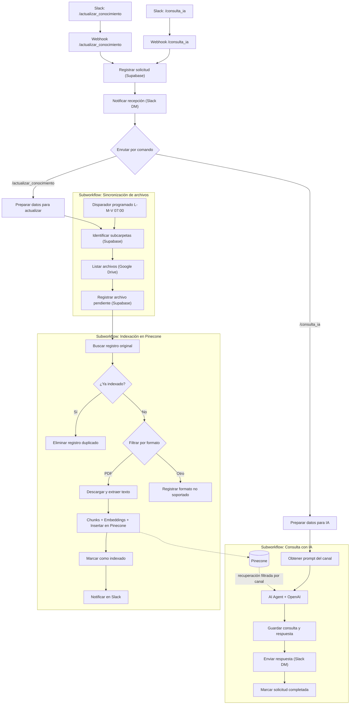

# RAG Drive – Asistente documental con IA para Slack

Sistema de consulta de documentación interna construido en **n8n**. Permite que los usuarios de un canal de Slack consulten, mediante lenguaje natural, los documentos PDF almacenados en Google Drive, con respuestas generadas por un agente de IA que recupera información desde una base de conocimiento vectorial (RAG).

## Índice

1. [Objetivo](#1-objetivo)
2. [Descripción del flujo](#2-descripci%C3%B3n-del-flujo)
3. [Diagrama del workflow](#3-diagrama-del-workflow)
4. [Tecnologías e integraciones](#4-tecnolog%C3%ADas-e-integraciones)
5. [Seguridad y manejo de credenciales](#5-seguridad-y-manejo-de-credenciales)
6. [Instrucciones de ejecución](#6-instrucciones-de-ejecuci%C3%B3n)
7. [Extra](#7-extra)
8. [A futuro](#8-a-futuro)

---

## 1. Objetivo

Centralizar el acceso a la documentación interna de la organización, reduciendo el tiempo de búsqueda manual en Google Drive. El proyecto resuelve tres necesidades:

- **Consultar** la documentación desde Slack con el comando `/consulta_ia`.
- **Mantener actualizada** la base de conocimiento con el comando `/actualizar_conocimiento`, que detecta e indexa los archivos nuevos de Drive.
- **Aislar el contexto por canal**: cada canal de Slack responde únicamente con los documentos y el prompt de sistema que tiene asignados.

## 2. Descripción del flujo

La solución se compone de **cuatro workflows**: un router principal y tres subworkflows reutilizables.

| Workflow | Tipo | Función |
| --- | --- | --- |
| RAG Drive \| Router de comandos de Slack | Principal | Recibe los comandos de Slack, registra la solicitud y la deriva según el comando. |
| RAG Drive \| Consulta con IA | Subworkflow | Responde consultas con un agente de IA y recuperación documental. |
| RAG Drive \| Sincronización de archivos | Subworkflow | Detecta los archivos de las subcarpetas de Drive y los registra. |
| RAG Drive \| Indexación en Pinecone | Subworkflow | Procesa los PDF y los incorpora a la base vectorial. |

### 2.1 Router de comandos de Slack

1. Dos **webhooks** (`/consulta_ia` y `/actualizar_conocimiento`) reciben el comando enviado por Slack (canal, usuario, comando y texto).
2. Se registra la solicitud en Supabase (`ragdrive_solicitudes`) con estado `procesando`.
3. Se envía al usuario un mensaje directo de Slack confirmando la recepción e informando el identificador de la solicitud.
4. Un nodo **Switch** enruta según el comando:
   - `/consulta_ia`: prepara la consulta y ejecuta el subworkflow de **Consulta con IA**.
   - `/actualizar_conocimiento`: prepara los datos del canal y ejecuta el subworkflow de **Sincronización de archivos**.

### 2.2 Consulta con IA

1. Recibe `solicitud_id`, `consulta`, `slack_user_id` y `slack_channel_id`.
2. Obtiene desde Supabase el **prompt de sistema** configurado para el canal (`ragdrive_prompts_por_canal`).
3. Un **AI Agent** (modelo de OpenAI) responde la consulta. Cuando necesita información documental, utiliza Pinecone como herramienta de recuperación: obtiene hasta 10 fragmentos relevantes, **filtrados por `slack_channel_id`**.
4. Guarda la consulta y la respuesta en el historial (`ragdrive_historial_consultas`).
5. Envía la respuesta al usuario por mensaje directo de Slack.
6. Actualiza la solicitud a estado `completado`.

### 2.3 Sincronización de archivos

1. Puede iniciarse de dos formas:
   - **Programada:** lunes, miércoles y viernes a las 07:00.
   - **Bajo demanda:** invocada por el router con `/actualizar_conocimiento`.
2. Identifica las subcarpetas de Drive a revisar a partir de las tablas de configuración de Supabase (`ragdrive_canales_slack`, `ragdrive_subcarpetas`, `ragdrive_carpetas_raiz`).
3. Lista los archivos de cada subcarpeta en Google Drive.
4. Registra cada archivo en `ragdrive_archivos` con sus metadatos (nombre, extensión, propietario, carpeta raíz, subcarpeta y canal de Slack).
5. Invoca el subworkflow de **Indexación en Pinecone**.

### 2.4 Indexación en Pinecone

1. Recibe el registro del archivo y recupera su registro original en Supabase.
2. **Control de duplicados:** si el archivo ya figura como `indexado`, elimina el registro de proceso duplicado y no lo vuelve a procesar.
3. Un nodo **Switch** valida el formato:
   - **PDF:** se descarga desde Drive, se extrae el texto, se divide en *chunks*, se generan los *embeddings* y se insertan en Pinecone con metadatos (`slack_channel_id`, `archivo_id`, carpeta raíz y subcarpeta).
   - **Otros formatos:** se registran como `no_indexado` con el motivo `formato_no_soportado`.
4. Un nodo de código consolida la salida en un único elemento por archivo y se actualiza `pinecone_estado` a `indexado`.
5. Se notifica en el canal de Slack que el documento ya puede consultarse.

## 3. Diagrama del workflow

## 4. Tecnologías e integraciones

| Componente | Uso |
| --- | --- |
| **n8n** | Orquestación de los workflows. |
| **Slack** | Comandos de entrada y notificaciones / respuestas por mensaje directo y canal. |
| **Supabase** | Registro de solicitudes, archivos, historial de consultas y configuración por canal. |
| **Google Drive** | Fuente de los documentos PDF. |
| **Pinecone** | Base de datos vectorial (índice `drive-documentos`). |
| **OpenAI** | Modelo de lenguaje del agente y generación de *embeddings*. |

**Nodos y recursos destacados de n8n:** Webhook, Execute Workflow / Execute Workflow Trigger, Schedule Trigger, Switch, IF, Set, Code, AI Agent, Vector Store (insert y retrieve-as-tool), Document Loader, Text Splitter, Extract From File.

## 5. Seguridad y manejo de credenciales

- Todas las integraciones (OpenAI, Pinecone, Supabase, Slack y Google Drive) utilizan **credenciales almacenadas en n8n**; no hay claves incluidas en los workflows ni en este repositorio.
- Los fragmentos recuperados se **filtran por `slack_channel_id`**, de modo que cada canal solo accede a su propia documentación.
- La indexación valida duplicados y formatos antes de procesar, evitando información repetida en la base vectorial.

## 6. Instrucciones de ejecución

### 6.1 Requisitos previos

- Instancia de n8n con acceso a Internet (ver [Extra](#7-extra)).
- Cuentas y credenciales de: OpenAI, Pinecone, Supabase, Slack y Google Drive.
- Un índice de Pinecone llamado `drive-documentos`.
- Una app de Slack con dos *slash commands*: `/consulta_ia` y `/actualizar_conocimiento`.

### 6.2 Preparación de Supabase

Crear las siguientes tablas:

| Tabla | Contenido |
| --- | --- |
| `ragdrive_solicitudes` | Solicitudes recibidas y su estado. |
| `ragdrive_archivos` | Archivos detectados, estado de indexación y errores. |
| `ragdrive_canales_slack` | Canales de Slack habilitados y su carpeta raíz. |
| `ragdrive_carpetas_raiz` | Carpetas raíz de Google Drive. |
| `ragdrive_subcarpetas` | Subcarpetas de Drive asociadas a cada carpeta raíz. |
| `ragdrive_prompts_por_canal` | Prompt de sistema del agente por canal. |
| `ragdrive_historial_consultas` | Historial de consultas y respuestas. |

### 6.3 Importación y configuración en n8n

1. Importar los workflows en este orden, ya que el router depende de los subworkflows:
   1. `RAG Drive | Indexación en Pinecone (subflujo)`
   2. `RAG Drive | Consulta con IA (subflujo)`
   3. `RAG Drive | Sincronización de archivos (subflujo)`
   4. `RAG Drive | Router de comandos de Slack`
2. Asignar las credenciales propias en cada nodo que las requiera.
3. Verificar que los nodos **Execute Workflow** apunten a los subworkflows importados (el ID cambia en cada instancia).
4. Activar los cuatro workflows.
5. En la app de Slack, configurar la **Request URL** de cada comando con la URL de producción del webhook correspondiente.

### 6.4 Uso

| Comando | Descripción | Ejemplo |
| --- | --- | --- |
| `/consulta_ia <pregunta>` | Consulta la documentación del canal. | `/consulta_ia ¿qué documentos tienes disponibles?` |
| `/actualizar_conocimiento` | Detecta e indexa los archivos nuevos del canal. | `/actualizar_conocimiento` |

Flujo esperado:

1. El usuario ejecuta un comando en el canal de Slack.
2. Recibe un mensaje directo con el identificador de la solicitud (`SLACK-XX`).
3. Al finalizar, recibe la respuesta por mensaje directo (consulta) o el aviso de indexación en el canal (actualización).

## 7. Extra

**Infraestructura de ejecución:** la instancia de n8n que ejecuta estos workflows se encuentra desplegada en un **VPS de Hetzner**.

## 8. A futuro

- Incorporar nuevos formatos de documento a la indexación: **Excel, Google Sheets y Word**.
- Desarrollar un **dashboard en Metabase** para controlar qué archivos fueron subidos a la base de conocimiento.